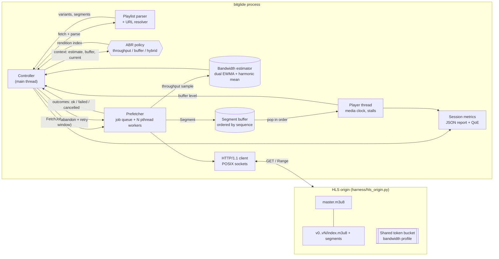

# BitGlide

**Adaptive bitrate (ABR) HLS streaming controller in C++17 for Linux.**

BitGlide plays an HLS stream through a simulated player and decides, segment by segment, which
quality rendition to download. It estimates available bandwidth in real time from segment
downloads, prefetches segments ahead of the playhead on a pool of POSIX worker threads with a
configurable lookahead, and manages the playback buffer so the player starts quickly, rarely
stalls and climbs to the highest quality the link can sustain. A Python/Bash harness serves a
synthetic multi-bitrate ladder through a bandwidth-shaped origin to replay network scenarios
(link collapse, oscillation, packet errors) and checks QoE metrics automatically.

## Features

- **HLS parsing**: master playlists (`BANDWIDTH`, `AVERAGE-BANDWIDTH`, `RESOLUTION`, `CODECS`) and
  media playlists (`EXTINF`, `MEDIA-SEQUENCE`, `BYTERANGE`, `ENDLIST`, VOD and live refresh).
- **Bandwidth estimation**: dual EWMA (fast/slow half-lives, conservative minimum) plus a
  sliding-window harmonic mean. Thread-safe, so workers can report samples concurrently.
- **Three ABR policies**:
  - `throughput`: highest rendition within `safety_factor x bandwidth`.
  - `buffer`: BBA-0 rate map from buffer occupancy (reservoir and cushion), with hysteresis.
  - `hybrid` (default): throughput-driven, with a panic guard on a low buffer, immediate
    down-switches unless the buffer can absorb the deficit, and one-step up-switches that need
    both bandwidth headroom and a healthy buffer.
- **Multi-threaded prefetching**: N `pthread` workers, a lookahead window (segments in flight) and
  a max-buffer cap; out-of-order completions are reassembled by sequence number.
- **Slow-download abandonment**: if the segment the player needs is taking longer than the
  remaining buffer, it is cancelled and fetched again from the lowest rendition.
- **Retries with fallback**: a failed segment is retried once on the same rendition, then on the
  lowest.
- **Simulated player thread**: tracks startup delay, stalls (rebuffering), switches and the
  bitrate weighted by play time. `--playback-rate` speeds up the media clock.
- **Session report**: a text summary on stdout and an optional JSON report with per-segment
  records, player events and a linear QoE score.
- **No third-party dependencies**: HTTP/1.1 is implemented on BSD sockets, and the unit tests use
  a small built-in framework.

## Architecture



### Threading model

| Thread | Count | Responsibility |
|---|---|---|
| `main` (controller) | 1 | Loads playlists, runs the ABR decision per segment, enforces lookahead and max buffer, handles retries and abandonment, and writes the report. |
| `bg-fetch-N` | `--workers` | Pulls jobs from the prefetch queue, downloads with cancellation, feeds the estimator and pushes into the buffer. |
| `bg-player` | 1 | Waits for the startup buffer, drains segments at the media clock rate and records stalls and switches. |

Shared state is guarded by mutexes and condition variables: the `SegmentBuffer` wakes the
player on push, the prefetch queue wakes the workers, and the outcome queue wakes the controller.
Threads are raw `pthread_create` handles wrapped in a small RAII class (`include/bitglide/thread.h`).

### Layout

```
include/bitglide/   public headers
src/                playlist, url, http_client, bandwidth_estimator, abr, segment_buffer,
                    player, prefetcher, controller, metrics, config, main
tests/              unit tests and the minimal test framework
harness/            gen_content.py, hls_origin.py, run_scenarios.py, profiles/*.json
scripts/            build.sh, run_tests.sh, scenario.sh
config/default.conf sample settings file
```

## Requirements

- Linux (macOS also works for development), with a C++17 compiler (GCC 9+ or Clang 10+)
- CMake 3.16+
- Python 3.8+ for the harness (standard library only)

You don't need any credentials or special hardware. HTTPS isn't supported, so point BitGlide at
`http://` or `file://` URLs.

## How to run

```bash
# 1. Build
scripts/build.sh                    # -> build/bitglide (add --sanitize for ASan/UBSan)

# 2. Generate a synthetic 4-rung ladder (400k / 1.2M / 2.5M / 5M, 30 x 2 s segments)
python3 harness/gen_content.py --out build/media

# 3. Serve it through a shaped link (pick a profile or a constant rate)
python3 harness/hls_origin.py --root build/media --port 8080 --profile harness/profiles/step_down.json
#   or: python3 harness/hls_origin.py --root build/media --port 8080 --kbps 3000

# 4. Stream it
build/bitglide --abr hybrid --workers 2 --lookahead 3 --report build/report.json \
    http://127.0.0.1:8080/master.m3u8
```

Steps 2 to 4 are wrapped by `scripts/scenario.sh step_down hybrid`.

BitGlide also accepts `file:///abs/path/master.m3u8`, which skips the network and is useful for
smoke tests. You can pass settings as flags, in a `key = value` file (`--config
config/default.conf`) or through the environment (`BITGLIDE_URL`, `BITGLIDE_LOG_LEVEL`). Run
`build/bitglide --help` for the full list. Here are the most useful flags:

| Flag | Default | Meaning |
|---|---|---|
| `--abr` | `hybrid` | `throughput`, `buffer` or `hybrid` |
| `--workers` | 2 | prefetch threads |
| `--lookahead` | 3 | max segments queued or in flight |
| `--max-buffer` | 30 | stop prefetching beyond this many seconds |
| `--safety-factor` | 0.85 | fraction of the estimated bandwidth to spend |
| `--startup-buffer` / `--resume-buffer` | 4 / 4 | seconds needed to start or resume playback |
| `--abandon-slow` | true | cancel downloads that would cause a stall |
| `--playback-rate` | 1.0 | media clock multiplier for faster simulations |

Example output (illustrative values):

```
BitGlide session summary (hybrid)
  played        60.000 s in 63.412 s wall
  startup delay 0.612 s
  stalls        0 (0.000 s)
  switches      3
  avg bitrate   3712.500 kbps
  downloaded    27.904 MB
  failures      0, abandons 0
  QoE score     3.402
```

## How to test

```bash
scripts/run_tests.sh               # build, unit tests (CTest), then every network scenario
scripts/run_tests.sh --unit-only   # unit tests only
scripts/run_tests.sh --compare     # scenarios for throughput, buffer and hybrid side by side
```

**Unit tests** (`tests/`, run with `ctest` or `build/bitglide_tests [filter]`) cover:

- URL resolution
- master and media playlist parsing, including byte ranges and malformed input
- estimator convergence, asymmetry and thread safety
- every ABR policy's decisions: safety factor, rate map, hysteresis, panic and up-switch guards
- segment buffer ordering, blocking, end-of-stream and close semantics
- config parsing

**Scenario tests** (`harness/run_scenarios.py`) start the shaped origin on a free port for each
profile in `harness/profiles/`, run `bitglide --report`, and check the JSON report against the
profile's `expect` block:

| Profile | Network | Expectation |
|---|---|---|
| `stable_high` | 12 Mbps | no stalls, average bitrate of at least 2.5 Mbps |
| `step_down` | 8 Mbps, then 0.9 Mbps, then 6 Mbps | at most 1 stall lasting at most 6 s, adapts both ways |
| `constrained` | 1 Mbps with 80 ms latency | at most 1 stall, average bitrate of at most 1.3 Mbps |
| `sawtooth` | 6 and 2 Mbps alternating every 8 s | bounded switch count |
| `flaky` | 6 Mbps with 8% HTTP 503 responses | completes using retries |

To add a scenario, drop a new JSON file into `harness/profiles/`. The runner prints a comparison
table and can save combined results with `--json-out`.

## Design notes

- ABR decisions are made when a segment is queued, not when it's played. The lookahead
  therefore trades reaction time for smoothness: a smaller `--lookahead` reacts faster to drops.
- All workers share one estimator. Parallel downloads split the link, so each sample
  underestimates per-connection throughput. That bias is conservative, and it's why the
  defaults use 2 workers.
- The QoE score follows the linear model from Yin et al. (SIGCOMM '15): bitrate (Mbps) minus 1.0
  times the bitrate change per switch, minus 4.3 times the stall seconds, averaged per segment.
